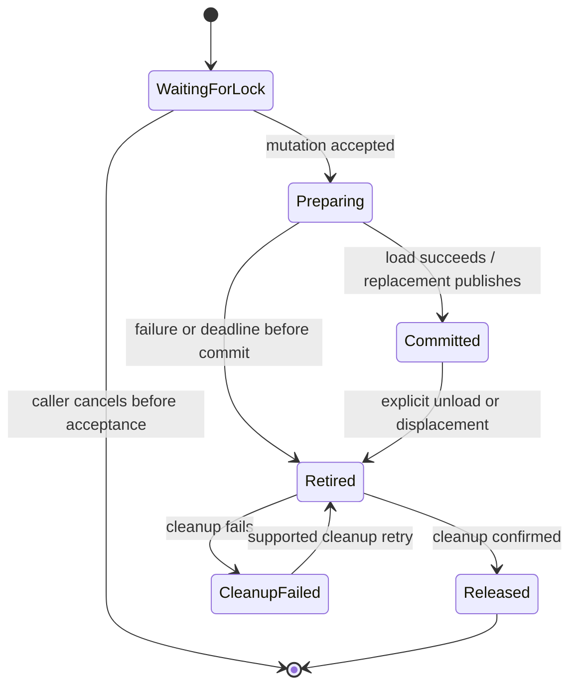

# Model lifecycle: theory of operation

This document describes model management within one MLServer process and its
workers. It is the reference for lifecycle changes and for future instrumentation.
The state names below describe the implementation; they are not new public API
values. Committed state is held in memory, not a durable transaction log.

## Owners and identities

| Component | Responsibility |
| --- | --- |
| `MultiModelRegistry` | Resolves a public model name to its `SingleModelRegistry`. |
| `SingleModelRegistry` | Serializes changes for that name; owns frontend instances, version/default selection, pending replacements, preparation and cleanup. |
| `InferencePoolRegistry` | Resolves the default, named or environment pool; serializes mutations sharing that pool key; retains initialization, extraction and failed-close owners. |
| `InferencePool` | Owns processes and their parent resources; tracks committed replay settings, staged preparation, uncertain updates and recovery. |
| `Dispatcher` and parent transport | Select routable workers, own response waiters and socket operations, and revoke stopped worker instances. |
| Worker `MultiModelRegistry` | Holds the actual runtime instances for that process and acknowledges model updates. |

A public `(name, version)` identifies a lookup, not a unique lifetime. Replacement
instances can have exactly the same name/version. A worker PID likewise identifies
an OS process number, not an incarnation forever. Resource cleanup follows the
actual instance. Worker update messages have distinct UUIDs, so an old response
cannot complete a newer update. These are internal lifecycle identities; W0 does
not introduce request-generation leases.

## State has several independent dimensions

| Dimension | Meaning |
| --- | --- |
| Registered | A frontend lookup can find the instance. A fresh loading entry can be registered before it is ready. |
| Prepared | Runtime loading and load hooks have succeeded for the candidate. A replacement can be prepared without being committed. |
| Committed | This instance/configuration is the selected generation. Replacement publication occurs before releasing the displaced instance. |
| Ready | The model's readiness flag is set. Public server readiness also follows existing startup and empty-registry settings. |
| Routable worker | The dispatcher may select this worker. Quarantine removes eligibility even when committed frontend settings remain intact. |
| Retired | The instance has lost serving eligibility; it may still own resources or unfinished cleanup. |
| Released | Cleanup has completed, or native process exit and parent-resource retirement have been confirmed. Removing a dictionary entry is insufficient evidence. |

For example, a published replacement can be ready while its pool is quarantined
after an unacknowledged cleanup update. An abandoned candidate can be absent from
lookups while its native preparation remains owned. Observability must preserve
these distinctions.

The frontend flow is:

This diagram omits the parallel pool's separate recovery state. A model mutation
can leave the caller while a retained owner continues preparing, reconciling or
cleaning. A failed pool close has a recorded terminal result, rather than the
local model cleanup retry shown above.

## Load, replacement and unload

A load waits for the name's lifecycle lock. Pool-backed hooks additionally resolve
the pool key and serialize mutations sharing that pool. Cancellation before lock
acceptance changes no model. After acceptance the existing deferred-cancellation
policy returns the operation's result/error despite caller cancellation, subject
to its configured cooperative deadline.

For a fresh load, the frontend can register a not-ready loading entry, runs hooks
in order, and awaits the exact runtime preparation task. A hook can transfer
ownership to a wrapper. Pool preparation requires acknowledgements from workers;
its frontend hook remains staged until subsequent hooks/preparation succeed.
Successful preparation marks the model ready and makes committed settings
eligible for later replay.

For a replacement, the previous instance remains selected while the candidate
prepares. At publication the new ready instance becomes selected before old-model
cleanup. Worker preparation and worker publication are distinct: prepared worker
replacements remain staged until the frontend sends the old-generation unload.
Precommit failure discards only the candidate and preserves the previous committed
identity/settings. Postcommit cleanup failure preserves the new committed state;
it can still make the operation report an error and can quarantine the pool.
An operation error alone therefore does not establish which generation is active.

Explicit unload removes serving eligibility and gives the selected exact instance
a retained cleanup owner before awaiting resource release. Public versionless
lookup/unload retains its existing default-version selection. Worker messages
target an exact version, including an unversioned instance; absence cannot select
and delete a healthy sibling version.

## Worker updates, recovery and retirement

Pool replay inventory records desired committed configuration, not every load
ever dispatched. A frontend deadline cannot retract an update already delivered
to a worker. The pool retains its waiter, quarantines the affected pool, and
settles the update before acknowledged rollback/cleanup restores routing.
Independent pools remain available. Other models sharing an uncertain pool lose
routing availability while their committed settings are retained.

A worker restart waits for staged publication and recovery before replay. It owns
the worker before native acquisition, replays the committed state, and publishes
readiness only after successful initialization. Abandoned candidates cannot enter
replay merely because a worker restarts. A stopped worker is revoked from routing
and transport sends, including sends queued from a foreign event loop. Confirmed
process exit and successful parent queue/feeder retirement are separate events.

Worker-stop and replay rollback transfer retirement ownership before transport
revocation. A socket-close error still permits response failure notification,
independent worker cleanup and the existing bounded replacement obligation.
Unreleased sockets remain owned by the transport, independently of child exit and
queue retirement. Replay keeps its initiating error and exposes a secondary
`cleanup_error`; failed cleanup stays observable and unfinished resources stay
owned. This does not add a restart retry loop.

Shutdown requests closure before waiting for lifecycle locks. Each manager retains
one close operation; repeated callers join it and observe its result/error.
Cancellation of a close waiter does not cancel cleanup. Existing deadlines and
bounded stop/kill/join mechanisms bound escalation; unfinished resources and errors
remain owned. Endpoint directories and owned environments outlive the resources
using them. Borrowed environments are never deleted.

## Basis for future observability

Instrumentation should record transitions and their owners, rather than infer
release or rollback from a caller's outcome. The following are semantic event/span
boundaries for future work; W0 does not implement these proposed signals.

| Boundary | Observation that matters |
| --- | --- |
| Requested / accepted | Separate time waiting for name/pool locks from time spent performing an accepted mutation. |
| Preparation started / settled | Record the actual instance and outcome, including settlement after caller deadline. |
| Replacement published | Identify the selected replacement and displaced instance independently of cleanup outcome. |
| Caller deadline / cancellation | Distinguish pre-acceptance cancellation, deferred cancellation and deadline expiry; none proves native interruption. |
| Worker update delivered / acknowledged | Correlate each message UUID and worker incarnation; retain late settlement as a separate observation. |
| Quarantine entered / recovery finished | Measure affected pool/model availability and the duration of uncertainty; failed recovery must not emit a routing-restored event. |
| Cleanup started / failed / confirmed | Separate retirement from actual resource release and preserve primary and secondary errors. |
| Worker exit / queues retired | Record confirmed status and separate parent-resource completion. A termination request is not an exit observation. |
| Close requested / completed / failed | Report the retained close result; a cancelled waiter is not a successful manager close. |

Logs/traces can correlate public model identity, an instance/operation correlation
identifier, pool key, worker incarnation/PID, message UUID and transport. Correlation
identifiers must describe actual implementation identities, not imply that W3
request ownership already exists. Avoid unbounded IDs as metric labels. Phase,
outcome and transport can support bounded counters/histograms; per-model or pool
labels need an explicit cardinality policy. Gauges for registered/loading models,
routable workers, quarantined pools and retained cleanup owners represent different
quantities and must not be combined into a single "loaded" count.

Measure preparation, publication-to-cleanup completion, reconciliation and close
separately. A request-duration metric ending at timeout cannot measure the lifetime
of native work that continues afterward. A successful replacement followed by old
cleanup failure is a committed replacement plus a cleanup failure, rather than a
failed publication.

## Limits and verification

Cooperative asyncio deadlines cannot interrupt a blocked event loop or establish
that native/thread/process work has stopped. Unsettled local native preparation
can retain a model name indefinitely; unconfirmed native or reader cleanup remains
an observable terminal failure. Arbitrary detached extension work is unsupported
unless its author supplies independent ownership and timeout boundaries.

W0 protects model publication, rollback identity, replay eligibility, quarantine,
worker/send ownership and repeatable cleanup outcomes at tested boundaries. It
does not guarantee safe retirement of every previously accepted inference holding
an old instance, nor provide general accepted/queued/in-flight generation leases.
That broader request ownership remains W3 work. Placement, caching, admission and
inference offloading must not infer those guarantees from W0.

The detailed ownership and failure contracts below qualify these flows.

## Detailed ownership contract

Lifecycle operations remain serialized by model name and by inference pool.
Acquiring the public operation lock accepts a mutation; cancellation while waiting
for that lock has no effect on models. After acceptance, the existing deferred
cancellation boundary returns the operation result or exception despite caller
cancellation. The configured deadline requests cancellation; it is not evidence
that native code, a thread, or a worker process stopped.

| Transition | Publication and ownership |
| --- | --- |
| Fresh load starts | The registry may expose a not-ready loading entry. |
| Hooks return | Ownership transfers to the returned model, including wrappers. A hook which raises must release resources it has not transferred. |
| Preparation completes | The registry marks the model ready. A replacement remains staged until the old generation is removed. |
| Replacement commits | The new ready instance is registered before old-instance cleanup. Cleanup failure preserves this committed instance. |
| Load fails before commit | Only the failed instance is removed. The previous instance and settings remain committed. |
| Runtime preparation exceeds the deadline | The exact preparation task stays owned; the instance is removed from serving, and cleanup waits for preparation to settle. Later mutations join this recovery before changing that name. |
| Unload starts | Serving eligibility is removed before cleanup. A retained cleanup task owns the exact instance independently of its waiter. |
| Cleanup fails | The error and instance remain owned. Loads report that failure; explicit unload retries cleanup. A load failure keeps its primary cause, and exposes `ModelLoadError.cleanup_error` when synchronous cleanup also fails. |

Local runtime preparation runs in an owned asyncio task. A blocked event loop
cannot deliver deadlines; a native call must return before Python can act. If an
owned preparation never settles, cleanup and subsequent mutations of that model
name cannot complete. The registry keeps that ownership and does not declare its
resources released. This does not introduce a server termination policy.

Unload-all first joins unfinished preparation and cleanup. It retries every
settled failed owner and attempts every committed version even if a retry fails.
Failed owners remain tracked; the first retained failure is reported after the
independent attempts finish. A deadline while waiting for uncertain work does not
start those independent mutations. Once instances are selected for bulk removal,
each receives a cleanup owner before the next await, so interruption cannot drop
an instance whose unload coroutine has not started.

Extension hooks must not leave unowned detached native work after returning or
raising. Wrappers must own the resources they replace. Arbitrary detached tasks
created by extensions are not covered by the nested timeout contract.

Custom REST routes bind directly to instances. Load abandonment revokes those
routes immediately, independently of cleanup waiting for native preparation.
Removal matches the instance's bound handlers, preserving committed routes for
other instances. Partial route-registration failure also revokes routes it added.

## Worker recovery

Pool and worker constructors now create lightweight owners. Internal pool users
await `start()` before using a dispatcher; normal `MLServer(settings)` followed
by `await server.start(...)` is unchanged. `InferencePoolRegistry.load_model()`
ensures activation itself, including for dynamic named/environment pools.
The registry retains the pool under its key before activation. Same-key loads
remain serialized. A retained initializing pool is not a committed model.

Activation acquires the response queue and endpoints, then starts the owned
dispatcher/transport before spawning children. Each worker is retained before
queue allocation or `Process.start()`, including a start which raises after
exposing a child. Never-started workers can retire acquired parent queues without
claiming a child exited. SIGCHLD notifies starting and failed owners as well as
active pools. Close prevents later spawning/publication and joins activation
with the existing model-operation bound before attempting independent cleanup.

Initialization failure preserves its primary exception; a secondary cleanup
failure is available as `cleanup_error` and on the retained pool. Confirmed
rollback removes a failed dynamic pool and permits retry. Failed cleanup keeps
the key blocked, its resources/environment retained, and the same close failure
observable to repeated callers. This is a recorded terminal failure, not an
automatic retry or an assertion that resources were released. Native allocation
failures without any returned handle/PID remain subject to the underlying
library's partial-acquisition guarantees; asyncio cannot interrupt blocking native
initialization. Borrowed environments are never deleted.

A pool retains its dispatched update waiter after frontend timeout. It immediately
removes all workers in that pool from routing. New pool mutations and replacement
worker replay join this recovery. Committed replay settings are copied; a fresh
load is added only after worker preparation succeeds, and failed replacements
never enter pending replay. The recovery owner waits for the delivered operation
to settle, then sends an unload (or replacement rollback) and requires its
acknowledgement before restoring surviving workers to routing. Per-message UUIDs
keep late responses separate from later operations. Retired frontend instances
cannot issue a second unload against a newer committed instance.

Worker unload updates target an exact version, including an unversioned instance.
If that attempted instance is absent, cleanup is a no-op; it cannot select a
healthy versioned default. Public versionless unload still selects the default.

A failed rollback or unacknowledged unload leaves the pool quarantined, with its
failure retained and reported by subsequent mutations. Close remains available.
An already dispatched operation which never settles remains owned and quarantined
until close confirms process exit. Other models in the same pool lose availability
during this conservative recovery; their committed configurations are retained.
Other pools remain independent. Update recovery adds no work to successful
predictions.

Worker load acknowledgements precede frontend wrapper construction and staging.
Failure in that interval also retires the attempted instance and enters owned,
acknowledged rollback. Caller cleanup must not issue an ordinary unload against
that abandoned candidate: doing so could commit the worker's pending replacement.
The previous committed replay settings survive this precommit failure.

The ZeroMQ parent transport revokes a selected worker instance even if its
forwarded send has not begun on the socket owner loop. The first send step checks
that instance's retained exit status before touching sockets. Exit zero is also
terminal; worker failure is reported as `WorkerStop`, while genuine caller
cancellation remains cancellation. Sockets, pending sends and response ownership
use the same worker identity, so stale cleanup cannot remove a replacement with
the same PID. Retired workers with unfinished queue cleanup also remain distinct
resource owners after PID reuse. Stop-status records are weakly keyed and store
only integers: queued work keeps its selected worker alive until settlement,
then collection can release the record. This adds one constant-time weak-key
status lookup to each ZeroMQ send; response bookkeeping uses weak instance keys in place of PID keys. Empty groups
remain weakly held so a concurrent schedule cannot lose its group during cleanup. Ready sends still avoid an
extra per-request future. No process polling, global inference lock or generation
lease is added.

Automatic pool retirement also counts staged frontend preparation and pending
replacements. Removing the last committed model cannot close
a pool still needed by an accepted load. Publication, or acknowledged cleanup of
an abandoned load, transfers/releases that owner before automatic retirement is
checked again. An otherwise empty abandoned pool may retire through its retained
close operation, which owns recovery through settlement or confirmed worker exit.
Explicit registry close remains terminal for all preparation.

## Close

Both pool and pool-registry close set closure requested before waiting for locks.
They create one retained cleanup task. Concurrent or repeated callers join it;
cancelling a caller stops only that caller's wait. Completed errors are reported
again. Pool close attempts independent cleanup even after a failure. A failed
pool is retained separately from pools eligible for new loads.

Lock draining uses the existing model-operation timeout. Worker shutdown uses
`parallel_workers_timeout` for graceful stop, then kill and bounded join. A worker
reference is retained if exit cannot be confirmed. These are cooperative Python
deadlines, not hard interruption of blocking native code or extension hooks.
Normal server shutdown and startup-error cleanup await registry close. Explicit
cancellation of the close waiter was the interrupted-close reproduction; that
probe did not establish a failure of normal, uninterrupted server shutdown.

Worker restart and recovery tasks use an explicit independent timeout context.
Awaited nested operations retain the existing shared timeout. Extension authors
spawning detached lifecycle work must give it an independent boundary and retain
its owner; inheriting a nested context does not create independent ownership.

Restart obligations wait for staged publication and recovery outside the pool
lock and initialization deadline. Actual spawn/replay retains its configured
deadline and is attempted once; failure is logged without an automatic retry
loop. Close cancels pending dependency/lock waiters and joins accepted startup,
retaining any unresolved worker owner instead of allowing late publication.
After startup settles, a final bounded sweep collects children which registered
after the first sweep. Close preserves earlier cleanup failures even if this
additional sweep succeeds.

A replacement PID is owned immediately after spawn, before dispatcher registration
can wait. This startup inventory is separate from routing and lifecycle broadcasts.
SIGCHLD records confirmed exit there even before registration; close includes those
children in its cleanup inventory. Retirement completion is recorded only after
parent endpoints and feeder threads are released, and failed retirement can retry.
An exit code alone never proves retirement. Empty replay also checks for exit before
readiness and uses the normal worker-stop path if polling observes death first.
Forced registration waits exercise defensive hardening; current serialized callers
do not normally prolong that interval. Initialization still has one bounded attempt.

If a killed worker leaves the response reader blocked, dispatcher shutdown reports
that reader as unrecoverable after a bounded thread join and retains the owner.
Python cannot forcibly terminate such a thread. This change does not add a policy
for killing the server process; an operator must handle an unrecoverable shutdown.

Environment extraction uses a retained task because its thread cannot be cancelled.
Retries join that task; they cannot treat a partial directory as a usable environment.
An incomplete marker also prevents reuse after the owner process exits. Failed
extractions retain their error and require removal of the incomplete directory
before retrying in a new registry. Close bounds its wait for extraction and reports
any unsettled owner without cancelling the underlying thread.

Successful pool close explicitly releases its extracted directory after resource
cleanup, before the pool key can be reused. Release revokes deletion authority on
retained old environment objects; collection cannot delete a later extraction.
Failed close retains that authority and blocks reuse. Borrowed directories are
never deleted, and worker copies cannot release their parent's directory.

Cancelling an owned local cleanup task also preserves its preparation reference.
A retry joins preparation before releasing resources. If preparation itself is
cancelled by external code, native completion cannot be established: cleanup
reports the uncertain state and keeps the owner rather than unloading concurrently.

SIGCHLD scheduling explicitly wakes the event loop. Scheduling a task from a raw
Python signal handler alone can leave a standard asyncio selector asleep until
unrelated IO or a timer, delaying worker exit handling and reconciliation.

When a frontend hook substitutes a model or changes its version, registration and
rollback follow instance identity. Earlier keys are removed, the previous committed
instance survives precommit failure, and default selection includes healthy sibling
versions. If preparation targets an already committed version, that target also
survives precommit failure. Publication retires both displaced instances and gives
each a cleanup owner before awaiting either; cleanup failure preserves publication.
Hooks must finalize the worker-visible identity before worker preparation;
renaming a worker model after dispatch is outside this ownership contract.

Confirmed worker exit releases child resources but does not settle parent queue
writers. Pool shutdown and worker retirement close obsolete parent readers only
after exit, then join each feeder with a bound before releasing its owner. A feeder
which cannot stop remains owned and reported. This also prevents interpreter-exit
queue finalizers from silently waiting on a dead consumer.

The feeder and retirement owner serialize closure of each parent reader. Native
descriptor close can release the GIL between checking and clearing the handle;
concurrent close calls could otherwise close the same descriptor twice. The lock
is installed before the feeder starts and adds no work to prediction dispatch.
